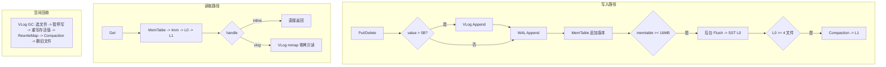

# ZeroKV 设计文档（Design Doc）

> 一份写给代码评审者 / 面试官 / 未来的自己的文档。
> 原则：每个设计决策都要能回答"为什么"；每个持久化格式都要能回答"崩溃后会发生什么"。

## 1. 总体架构



## 2. 关键数据格式

### 2.1 DataHandle —— 64 位值句柄

| bits | 63–62 | 61–60 | 59–40 | 39–30 | 29–0 |
|---|---|---|---|---|---|
| 含义 | Tier | Type | Size (≤1MB) | FileID (≤1023) | Offset (≤1GB) |

- `INLINE`：值 ≤ 5B，直接嵌入低 40 位（5 字节），零额外 IO
- `VLOG`：大值存 Value Log，句柄只记 (FileID, Offset, Size)
- `TOMBSTONE`：`raw == 0`

> 为什么阈值是 5 字节：inline 负载受 40-bit 位域限制，5B 是能安全存放的最大值。真实系统（如 RocksDB 的 BlobDB）会用"值大小 + 工作负载"动态选择阈值。

### 2.2 WAL 记录

| 字段 | total_len | crc32 | seq | key | val_len | type | value |
|---|---|---|---|---|---|---|---|
| 长度 | 4B | 4B | 8B | 8B | 4B | 1B | val_len |

- CRC 覆盖 `seq..value`（不含 total_len 本身）
- 恢复时完整记录逐条回放；**尾部半写记录直接截断丢弃**（CRC 失败即停止）
- 轮转：MemTable Flush 落盘（含 `fdatasync`）后才截断 WAL

### 2.3 SSTable 文件布局

```
[DataBlock 0][DataBlock 1]...[Meta(Index)][Filter][Footer(32B)]
DataBlock := entries | seq_array | restart_points | num_restarts
Footer    := meta_offset(8) | filter_offset(8) | filter_size(8) | magic(8)
```

- DataBlock 超过 64KB 或满 16 条重启点后落盘，先 LZ4 压缩（无收益则存 RAW），附 CRC32
- Index：每块首 key → 文件偏移
- 读取：footer → filter（前缀 Bloom 快速否定）→ index 二分 → 分片 LRU Block Cache → 重启点二分 + 顺序扫描

### 2.4 Value Log 记录

```
[total_len(4) | crc32(4) | key_len(4) | val_len(4)][key(8)][value]
```

- 顺序 Append，文件到 900MB 轮转；读走 mmap 零拷贝（PinnableSlice）
- `discardable_size` 记账：每个被取代的旧版本累计记为"可回收"，供 GC 选文件

## 3. 写入路径

1. `gc_pause_mtx_` 共享锁（GC 时被独占，暂停写入）
2. WriteController 背压检查（L0 文件数 / Imm 数量 → DELAY / STOP）
3. 分配全局递增 seq
4. value > 5B：直接追加 VLog（不再做全路径旧句柄查找）
5. WAL 追加（CRC）
6. MemTable（无锁跳表）**追加式版本链插入**：同 key 的新版本追加在版本运行（run）末尾，节点链接后不可变；插入时即可确定"哪个版本成为垃圾"（本版本 seq 更大 → 旧最新版本作废；本版本 seq 更小 → 自身立即作废），就地记 discardable —— 版本链记账，O(跳表查找)
7. 达 16MB 阈值 → 切 Imm → 后台线程 Flush 成 SST → 轮转 WAL

## 4. 读取路径

查找顺序：**MemTable → Immutable（新→旧）→ L0（新→旧）→ L1（有序）**

MemTable 内沿版本链遍历同 key 的整个 run，取 **seq 最大** 的版本；跨层比较同样以 seq 为准。遇 tombstone 即返回"不存在"。大值经 VLog mmap 直接零拷贝 pin 给上层。

## 5. Flush 与 Compaction

- **Flush**：MemTable 切为 Imm 后不再接收写入，后台线程遍历写出单个 L0 SST（**多版本 SST**：同 key 的整条版本链全部写入，读路径按 seq 取最新）
- **触发**：L0 ≥ 4 个文件，或 L1 内部 key 区间重叠
- **MergeIterator**：统一迭代器接口多路归并（MemTable / Imm / L0 / L1 同堆归并）；同 Key 按 seq 从新到旧；bottom level 丢弃墓碑（`prev_key` 先置位再判墓碑，保证墓碑后的旧版本同样被丢弃，修复"删除后 key 复活"隐患）；丢弃的旧版本经 `handle_obsolete` 回调统一记 discardable；应用 GC RewriteMap 改写保留版本句柄
- **原子可见性**：落盘后原子替换 MANIFEST（tmp + rename + 目录 fsync），再删除旧文件

## 6. VLog GC 协议

1. `PickGCFile`：跳过当前文件与 GC 文件，选 discardable 比例最高者（≥ 阈值）
2. 独占 `gc_pause_mtx_`（暂停新写入）→ Flush 活跃 MemTable → 等后台任务完成
3. 逐记录扫描旧文件（CRC 校验），用 `checker` 判断"该 key 的最新版本是否仍指向这个位置"
   - 是 → 重写进 GC 文件，记入 RewriteMap
   - 否（已删除 / 已更新）→ 跳过（垃圾）
4. 注入 RewriteMap → 全局 Compaction 改写 SST 中旧句柄 → 落盘
5. 删除旧 VLog 文件

> **discardable 记账来源**：① 写路径版本链（插入时确定作废版本，就地记账，覆盖"同一 MemTable 内"的覆盖）；② Compaction 去重回调（跨层覆盖：旧版本已落盘、新版本在更新层）。被就地作废的版本不会进入 SST，两条路径不重复。
> **checker 是权威**：记账只是选文件的启发式，GC 扫描时逐条比对最新版本，精确决定重写/跳过，因此记账偏差不影响正确性。

> **崩溃窗口分析**：先 Compaction 落盘、后删旧文件。
> - 第 4 步前崩溃：旧文件还在，SST 仍指向旧句柄，数据完整；
> - 第 4 步后、第 5 步前崩溃：SST 已指向新文件（GC 文件恢复时经 CRC 扫描回放），旧文件删除失败也无妨。
>
> 因此任何时刻都不会出现"句柄指向已删除文件"的悬垂引用。

## 7. 崩溃恢复顺序

1. **VLog 扫描截断**：逐文件按 CRC 找到最后一个完整记录，`ftruncate` 掉尾部半写
2. **MANIFEST**：重建 SST 列表与 file_id / seq 水位
3. **WAL 回放**：完整记录插入 MemTable；回放时校验句柄指向的 VLog 位置未越界（依赖第 1 步的 valid_size）
4. `next_seq = max(manifest_max_seq, wal_max_seq) + 1`

## 8. 并发控制

| 资源 | 机制 |
|---|---|
| MemTable 切换 | `shared_mutex`（读共享、切换独占） |
| Imm 列表 | `shared_mutex` |
| SST 列表 | `shared_mutex`（Compaction 替换时独占） |
| 写 vs GC | `gc_pause_mtx_` 独占暂停 |
| 跳表遍历 | EpochGuard（读 pin epoch，回收方等两个 epoch） |
| 同 Key 覆盖 | 追加式版本链：节点链接后不可变，无撕裂窗口（无需 16 字节原子） |
| 节点分配 | 线程本地内存池 + 跨线程窃取 + 全局 free list |
| 写放大控制 | WriteController 状态机（NORMAL / DELAY / STOP，带迟滞） |

## 9. 已知权衡与限制

1. （已修复）写路径 GC 记账：由"每次写入全层查找最新句柄"改为版本链记账，跨层覆盖由 Compaction 去重回调补齐
2. （已修复）跳表同 Key 覆盖：由两步更新改为追加式版本链，读者看到的是完整不可变三元组
3. （已修复）DBIterator 通过统一迭代器接口合并 MemTable / Imm / L0 / L1，范围扫描覆盖未落盘数据
4. 前缀 Bloom：假阳性率由"前缀数量"决定而非"key 数量"，同前缀密集 key 空间下精度弱于标准全 Key 布隆
5. 范围扫描无快照隔离；单次 key/value 读取是原子的
6. 单日志串行写：VLog/WAL 全局互斥，并发写吞吐受限（Roadmap：group commit）
7. MANIFEST 存绝对路径 → 目录不可整体移动；仅支持 Linux
