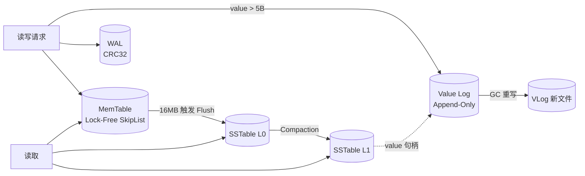

# ZeroKV

> 一个面向学习与实践的单机 KV 存储引擎：LSM-Tree 架构 + WiscKey 风格 KV 分离。
> 技术栈：C++20 · Linux · LZ4 · Zlib · CMake


## 项目简介

ZeroKV 实现了现代存储引擎的核心机制：

- **写入路径**：WAL（预写日志）→ 无锁跳表 MemTable → 达到阈值后 Flush 为 SSTable（L0 → L1 Compaction）
- **KV 分离**：超过 5 字节的值走 Append-Only Value Log，元数据层只存 8 字节句柄
- **版本链**：MemTable 采用 LevelDB 式追加版本链，同 Key 多版本共存、按 seq 取最新，并发覆盖无撕裂窗口
- **崩溃一致性**：WAL + CRC32 + MANIFEST 原子替换，掉电 / `kill -9` 后可恢复
- **空间回收**：VLog 按垃圾率选文件 → 扫描重写 → Rewrite Map → Compaction → 删旧文件
- **并发**：多线程写入、Epoch-Based 内存回收、线程本地内存池、写背压控制

## 特性一览

| 模块 | 实现 |
|---|---|
| MemTable | 无锁跳表：CAS 插入 + 追加式版本链 + EpochGuard 读保护 + 线程本地内存池 |
| WAL | 变长记录 + CRC32 + 尾部撕裂截断恢复 + 轮转 |
| SSTable | LZ4 压缩块 + 重启点二分 + 前缀 Bloom Filter + mmap + 分片 LRU Block Cache |
| Value Log | Append-Only + CRC + mmap 零拷贝读 + discardable 记账 |
| GC | 按垃圾率选文件 → 暂停写 → 扫描重写 → Rewrite Map → 全局 Compaction → 删旧文件 |
| Compaction | 统一迭代器接口多路归并（同 Key 取最新 Seq，底层丢墓碑 + 旧版本统一记账） |
| 范围扫描 | DBIterator 合并 MemTable + Immutable + L0 + L1，未落盘数据可见 |
| 并发控制 | shared_mutex 分级锁 + WriteController 背压 + 后台线程池 |
| 测试 | 组件级测试 + 7 项全量基准 + CI（GCC/Clang、ASan/UBSan/TSan） |

## 架构图



## 目录结构

```
ZeroKV/
├── include/
│   └── DB.hpp                 # 存储引擎核心 API 接口（对外暴露）
├── src/                       # 核心源码目录
│   ├── core/                  # 核心基础组件
│   │   ├── Coding.hpp         # 变长编码与解码
│   │   ├── FileUtils.hpp      # 文件 I/O 与工具函数
│   │   ├── MemPool.hpp        # 线程本地内存池 + 跨线程窃取
│   │   ├── Status.h           # 统一状态码与错误处理
│   │   └── ThreadPool.hpp     # 后台异步线程池（基于 C++20 jthread）
│   ├── iterators/             # 迭代器组件
│   │   ├── DBIterator.hpp     # 全局统一迭代器
│   │   ├── KVStoreIterator.hpp# KV 存储迭代器基类
│   │   ├── MemTableIterator.hpp# MemTable 迭代器
│   │   └── MergeIterator.hpp  # 多路归并迭代器
│   ├── memtable/              # 内存表组件
│   │   ├── EpochManager.hpp   # Epoch-Based 无锁内存回收管理器
│   │   └── LockFreeSkipList.hpp # 无锁跳表（MemTable 底层数据结构）
│   ├── process/               # 业务流程控制
│   │   ├── CompactionTask.hpp # 压缩任务（Merge + Rewrite + 旧版本记账）
│   │   ├── DataHandle.h       # 64 位值句柄位域布局（KV 分离指针）
│   │   ├── PinnableSlice.hpp  # 防悬垂安全字符串切片
│   │   └── WriteController.hpp# 写背压（Write Stall）状态机
│   ├── sstable/               # 磁盘持久化组件（SSTable）
│   │   ├── BloomFilter.hpp    # 前缀布隆过滤器（加速点查过滤）
│   │   └── SSTable.hpp        # SSTable 读写（LZ4 压缩、重启点、Block Cache、mmap）
│   └── wal/                   # 预写日志组件
│       ├── ValueLog.hpp       # KV 分离大值日志（Value Log）
│       ├── ValueLogGC.hpp     # Value Log 空间回收机制（GC）
│       └── WAL.hpp            # WAL 预写日志（CRC32 校验、崩溃恢复、轮转截断）
├── tests/                     # 测试代码目录
│   ├── scripts/
│   │   └── run_robustness_crash.sh # 极端崩溃恢复可靠性测试脚本（kill -9）
│   ├── bench.cpp              # 7 项全量基准测试（Benchmark）
│   ├── component_tests.cpp    # 9 大核心组件逐项压测与交互测试
│   ├── robustness_tests.cpp   # 故障注入、IO 异常与并发崩溃恢复测试
│   └── unit_tests.cpp         # 原子单元测试（覆盖编码、布隆过滤器等）
├── docs/                      # 项目文档
│   └── DESIGN.md              # 核心架构与设计文档
├── .github/
│   └── workflows/
│       └── ci.yml             # GitHub Actions CI 持续集成流程（含 ASan/TSan/崩溃测试）
├── CMakeLists.txt             # CMake 构建配置
├── LICENSE                    # 项目开源协议
├── README.md                  # 项目说明文档
└── .gitignore                 # Git 忽略配置
```

## 快速开始

### 环境要求

- Linux（依赖 `mmap` / `fdatasync` / `O_DIRECTORY` 等 POSIX 接口）
- g++ ≥ 10 或 clang ≥ 12（C++20：concepts、jthread）
- CMake ≥ 3.20；liblz4-dev、zlib1g-dev

```bash
# Ubuntu / Debian 依赖
sudo apt-get install -y g++ cmake liblz4-dev zlib1g-dev

# 方式一：直接编译
g++ -O3 -std=c++20 -march=native bench.cpp -o full_bench -llz4 -lz -lpthread
./full_bench
sudo ./full_bench   # root 权限下会 drop page cache，冷读数据更准确

# 组件级测试
g++ -O2 -std=c++20 -march=native component_tests.cpp -o component_tests -llz4 -lz -lpthread
./component_tests

# 方式二：CMake
# 全部测试（单元 + 组件 + 可靠性 + 崩溃注入）
cmake -B build -DCMAKE_BUILD_TYPE=Release
cmake --build build -j$(nproc)
ctest --test-dir build --output-on-failure

# 单独运行
./build/zerokv_tests                    # 单元测试
./build/zerokv_component_tests          # 组件级测试
./build/zerokv_robustness_tests         # 可靠性专项
./build/zerokv_robustness_tests crash   # 只跑指定组（按名称前缀过滤）
```

### Sanitizer 构建（并发正确性）

```bash
cmake -B build-asan -DCMAKE_BUILD_TYPE=Debug -DZEROKV_SANITIZE=address,undefined
cmake --build build-asan -j$(nproc) && ./build-asan/zerokv_tests

cmake -B build-tsan -DCMAKE_BUILD_TYPE=Debug -DZEROKV_SANITIZE=thread
cmake --build build-tsan -j$(nproc) && ./build-tsan/zerokv_tests
```

## 基准测试

7 项基准：顺序写 / 点查命中 / 点查未命中（热 vs 冷）/ 范围扫描（SST + MemTable）/ 4 线程并发写 / WAL 崩溃恢复 / VLog GC。

> 运行条件：`sudo ./full_bench`，[3/7] 冷未命中前已 drop OS page cache，因此 [4/7] 及之后均为冷缓存环境。

| # | 测试项 | 数据量 | 耗时 | QPS / ops | 备注 |
|---|---|---|---|---|---|
| 1 | 顺序写 | 500,000 | 1,500.97 ms | 333,117 ops/s | |
| 2 | 点查（命中） | 200,000 | 72.70 ms | 2,751,057 QPS | |
| 3 | 点查（未命中，热） | 200,000 | 8.10 ms | 24,705,123 QPS | 误报 0 |
| 4 | 点查（未命中，冷） | 200,000 | 8.09 ms | 24,720,024 QPS | drop page cache 后 |
| 5 | 范围扫描（SST，Seek+100×Next） | 10,000 | 451.20 ms | 999,967 条 | 冷缓存 |
| 5b | 范围扫描（MemTable 未落盘） | 50,000 | 4.47 ms | — | 全量可见且有序 |
| 6 | 4 线程并发写 | 500,000 | 3,967.52 ms | 126,023 ops/s | 校验 100% |
| 7 | VLog GC | 100,000 × 1KB × 3 版本 | 317871 KB | — | 回收 214,105 KB，完整性 100% |

环境：`CPU: AMD Ryzen 9 9900X（分配 4 核）| 内存: 32GB DDR5 | 磁盘: NVMe SSD（PCIe 3.0）| 系统: Ubuntu 22.04 server`

### 结果要点

- **冷未命中 ≈ 热未命中**：未命中路径由前缀 Bloom 直接否定，且索引块常驻进程内 BlockCache，几乎不触发磁盘 IO；冷/热差距主要体现在命中大 Value 与范围扫描（同机未 drop cache 时 SST 扫描为 93.40 ms，drop 后 451.20 ms）。
- **崩溃恢复**：重开实例后 10,000/10,000 全部恢复，WAL + CRC 尾部截断逻辑验证通过。
- **VLog GC**：扫描阶段用最新版本 checker 逐条校验，精确识别 200,000 条垃圾记录；回收 214,105 KB（≈ 写入量的 2/3），回收后 100,000 个 key 全部读到最新值。
- **并发写低于单线程**：写入在 VLog 与 WAL 上全局串行化（单日志顺序写设计），多线程只有锁竞争开销；group commit 已列入 Roadmap。

## 可靠性测试

除基准测试外，ZeroKV 的可靠性由四层测试体系保证，全部集成进 CI（`ctest`）：

| 层级 | 内容 | 结果 |
|---|---|---|
| 单元测试 | 12 组、43,912 个断言：位域打包 / 编解码 / Bloom / WAL 往返与撕裂 / 持久化重开 / 范围扫描 / GC 完整性 / 并发写 | ✅ 0.32s 全过 |
| 组件级测试 | 9 个组件逐项正确性 + 微基准 | ✅ 0.58s 全过 |
| 可靠性专项 | 7 组定向测试：目录 fsync / 删除 / KV 分离 / 原子性 / IO 错误 / 版本链 / fork 崩溃恢复 | ✅ 1,549 断言全过 |
| 随机崩溃注入 | 随机 `kill -9` + 重启校验，committed keys 恢复率 100% | ✅ 10/10 轮通过 |

### 组件级测试结果

| 组件 | 结果 |
|---|---|
| DataHandle | 200 万次编解码 0.08 µs ✅ |
| Coding | 200 万次往返 0.02 µs ✅ |
| BloomFilter | 构建 1 万 key 0.15 ms；查询 11 万次 1.08 ms；误报率 0.837%（与理论值 ≈0.82% 一致） ✅ |
| WAL | 追加 10 万条 51.91 ms；恢复 5.42 ms；尾部撕裂截断 OK ✅ |
| LockFreeSkipList | 写 20 万 14.48 ms；读 20 万 9.07 ms；4 线程并发写读 59.52 ms ✅ |
| SSTable | 写 10 万条 6.62 ms（1,180 KB）；点查 5.63 ms；范围扫描 5 万条 0.56 ms ✅ |
| ValueLog | 追加 10 万条 147.14 ms；逐条校验读回 100,000/100,000 ✅ |
| DB + VLog GC | 2 万 key × 3 版本覆盖 + 1,000 删除；回收 13,168 KB；完整性 19,000/19,000 ✅ |
| DBIterator | MemTable 未落盘扫描 4,949/4,949 且有序 ✅ |

### 可靠性专项（7 组）

| # | 专项 | 验证点 |
|---|---|---|
| 1 | 目录 fsync / MANIFEST | 原子替换（tmp 不残留）、残留 tmp 被忽略、坏行/孤儿条目容错；`strace` 可验证 `fdatasync(tmp) → rename → fsync(目录)` 完整调用链 |
| 2 | 删除 | 大值/小值/覆盖删除、删除不存在的 key、重启 / Compaction / GC 后不复活 |
| 3 | KV 分离（VLog） | ≤5B 走 inline（VLog 零增长）、>5B 落盘且读回一致、尾部半写 CRC 截断恢复 |
| 4 | manifest/SST 原子性 | 孤儿 SST 忽略、MANIFEST 指向缺失文件跳过、损坏 SST fail-fast（拒绝打开而非返回错误数据） |
| 5 | IO 错误 | 打开失败抛异常不崩、VLog 文件丢失优雅降级（读返回 false + 新写入可用）、WAL 损坏截断 |
| 6 | 版本链 | 顺序/并发覆盖无撕裂、inline↔VLog 交替覆盖、墓碑复活、重启 / GC 后取最新 |
| 7 | 崩溃恢复（fork） | WAL 轮转截断、轮转后的写入在崩溃后完整恢复 3,500/3,500 |

### 随机崩溃注入

```bash
bash tests/scripts/run_robustness_crash.sh 10
```

## 设计文档

详见 [docs/DESIGN.md](docs/DESIGN.md)：数据格式（DataHandle / WAL / SST / VLog）、写入与读取路径、Flush 与 Compaction、GC 协议与崩溃窗口分析、恢复流程、并发控制与已知权衡。

## 已知限制

1. Key 固定为 `uint64_t`（通用 Slice/字符串 Key 在 Roadmap）
2. Bloom Filter 使用 32 位前缀语义：对"同前缀密集 key 空间"，假阳性率由前缀数量决定而非 key 数量；换来的好处是体积更小、构建去重
3. 范围扫描不提供快照隔离（扫描过程中新写入对结果的可见性无保证；单次 key/value 读取是原子的）
4. 单日志串行写：多线程写入在 VLog/WAL 全局互斥，并发写吞吐受限（Roadmap：group commit / 多段 VLog）
5. discardable 记账是启发式统计（写路径版本链 + Compaction 兜底），GC 选文件按估算比例，扫描时以 checker 逐条校验为准；崩溃后统计从零重建，不影响正确性
6. 仅支持 Linux；MANIFEST 记录绝对路径（数据库目录不可整体移动）

## Roadmap

- [ ] Snapshot / MVCC
- [ ] 通用 Slice Key + 字符串 Key 支持
- [ ] DeleteRange / 前缀扫描 API
- [ ] Group Commit（并发写吞吐）
- [ ] 与 RocksDB 的对照基准（同机器同负载）
- [ ] 崩溃注入测试（随机 `kill -9` 循环验证）
- [ ] 基于 ZeroKV 的 Raft 分布式层

## License

MIT — 见 [LICENSE](LICENSE)

## 参考

- LevelDB / RocksDB 的 LSM 实现
- [WiscKey: Separating Keys from Values in SSD-conscious Storage (FAST '16)](https://www.usenix.org/conference/fast16/technical-sessions/presentation/lu)
