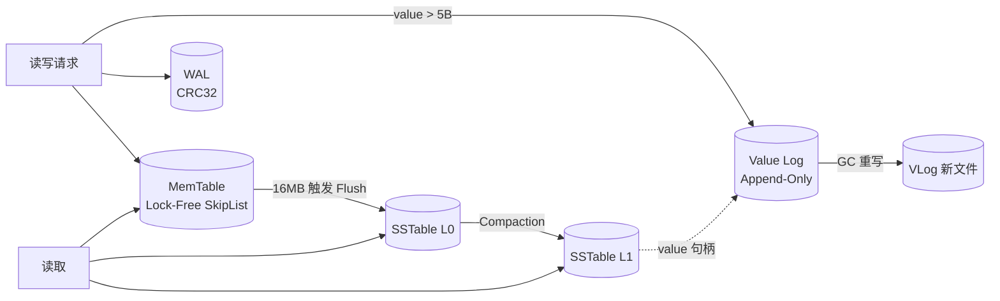

# ZeroKV

> 一个面向学习与实践的单机 KV 存储引擎：LSM-Tree 架构 + WiscKey 风格 KV 分离。
> 技术栈：C++20 · Linux · LZ4 · Zlib · CMake


## 项目简介

ZeroKV 实现了现代存储引擎的核心机制：

- **写入路径**：WAL（预写日志）→ 无锁跳表 MemTable → 达到阈值后 Flush 为 SSTable（L0 → L1 Compaction）
- **KV 分离**：超过 5 字节的值走 Append-Only Value Log，元数据层只存 8 字节句柄
- **版本链**：MemTable 采用 LevelDB 式追加版本链，同 Key 多版本共存、按 seq 取最新，并发覆盖无撕裂窗口
- **崩溃一致性**：WAL + CRC32 + MANIFEST 原子替换，掉电 / `kill -9` 后可恢复
- **空间回收**：VLog 按垃圾率选文件 → 扫描重写 → Rewrite Map → Compaction → 删旧文件
- **并发**：多线程写入、Epoch-Based 内存回收、线程本地内存池、写背压控制

## 特性一览

| 模块 | 实现 |
|---|---|
| MemTable | 无锁跳表：CAS 插入 + 追加式版本链 + EpochGuard 读保护 + 线程本地内存池 |
| WAL | 变长记录 + CRC32 + 尾部撕裂截断恢复 + 轮转 |
| SSTable | LZ4 压缩块 + 重启点二分 + 前缀 Bloom Filter + mmap + 分片 LRU Block Cache |
| Value Log | Append-Only + CRC + mmap 零拷贝读 + discardable 记账 |
| GC | 按垃圾率选文件 → 暂停写 → 扫描重写 → Rewrite Map → 全局 Compaction → 删旧文件 |
| Compaction | 统一迭代器接口多路归并（同 Key 取最新 Seq，底层丢墓碑 + 旧版本统一记账） |
| 范围扫描 | DBIterator 合并 MemTable + Immutable + L0 + L1，未落盘数据可见 |
| 并发控制 | shared_mutex 分级锁 + WriteController 背压 + 后台线程池 |
| 测试 | 组件级测试 + 7 项全量基准 + CI（GCC/Clang、ASan/UBSan/TSan） |

## 架构图



## 目录结构

```
ZeroKV/
├── bench.cpp              # 7 项全量基准测试
├── component_tests.cpp    # 组件级测试（9 个组件逐项压测）
├── DB.hpp                 # 存储引擎主体：Put/Get/Delete/迭代器/Flush/Compaction/GC
├── LockFreeSkipList.hpp   # 无锁跳表 MemTable（追加式版本链）
├── EpochManager.hpp       # Epoch-Based Reclamation（无锁内存回收）
├── MemPool.hpp            # 线程本地内存池 + 跨线程窃取
├── WAL.hpp                # 预写日志：CRC32、恢复、轮转
├── SSTable.hpp            # SST 读写：LZ4、重启点、Block Cache、mmap
├── BloomFilter.hpp        # 前缀 Bloom Filter
├── ValueLog.hpp           # KV 分离日志（Append-Only + mmap）
├── ValueLogGC.hpp         # Value Log 垃圾回收
├── CompactionTask.hpp     # 压缩任务（Merge + Rewrite + 旧版本记账）
├── KVStoreIterator.hpp    # 统一迭代器接口
├── MergeIterator.hpp      # 多路归并迭代器
├── MemTableIterator.hpp   # MemTable 迭代器
├── DBIterator.hpp         # 范围扫描迭代器（四层合并）
├── DataHandle.h           # 64 位值句柄位域布局
├── ThreadPool.hpp         # 后台线程池（C++20 jthread）
├── WriteController.hpp    # 写背压状态机
├── docs/DESIGN.md         # 设计文档
├── CMakeLists.txt
└── .github/workflows/ci.yml
```

## 快速开始

### 环境要求

- Linux（依赖 `mmap` / `fdatasync` / `O_DIRECTORY` 等 POSIX 接口）
- g++ ≥ 10 或 clang ≥ 12（C++20：concepts、jthread）
- CMake ≥ 3.20；liblz4-dev、zlib1g-dev

```bash
# Ubuntu / Debian 依赖
sudo apt-get install -y g++ cmake liblz4-dev zlib1g-dev

# 方式一：直接编译
g++ -O3 -std=c++20 -march=native bench.cpp -o full_bench -llz4 -lz -lpthread
./full_bench
sudo ./full_bench   # root 权限下会 drop page cache，冷读数据更准确

# 组件级测试
g++ -O2 -std=c++20 -march=native component_tests.cpp -o component_tests -llz4 -lz -lpthread
./component_tests

# 方式二：CMake
cmake -B build -DCMAKE_BUILD_TYPE=Release
cmake --build build -j$(nproc)
./build/zerokv_bench
ctest --test-dir build --output-on-failure
```

### Sanitizer 构建（并发正确性必跑）

```bash
cmake -B build-asan -DCMAKE_BUILD_TYPE=Debug -DZEROKV_SANITIZE=address,undefined
cmake --build build-asan -j$(nproc) && ./build-asan/zerokv_tests

cmake -B build-tsan -DCMAKE_BUILD_TYPE=Debug -DZEROKV_SANITIZE=thread
cmake --build build-tsan -j$(nproc) && ./build-tsan/zerokv_tests
```

## 基准测试

7 项基准：顺序写 / 点查命中 / 点查未命中（热 vs 冷）/ 范围扫描（SST + MemTable）/ 4 线程并发写 / WAL 崩溃恢复 / VLog GC。

> 运行条件：`sudo ./full_bench`，[3/7] 冷未命中前已 drop OS page cache，因此 [4/7] 及之后均为冷缓存环境。

| # | 测试项 | 数据量 | 耗时 | QPS / ops | 备注 |
|---|---|---|---|---|---|
| 1 | 顺序写 | 500,000 | 1,500.97 ms | 333,117 ops/s | |
| 2 | 点查（命中） | 200,000 | 72.70 ms | 2,751,057 QPS | |
| 3 | 点查（未命中，热） | 200,000 | 8.10 ms | 24,705,123 QPS | 误报 0 |
| 4 | 点查（未命中，冷） | 200,000 | 8.09 ms | 24,720,024 QPS | drop page cache 后 |
| 5 | 范围扫描（SST，Seek+100×Next） | 10,000 | 451.20 ms | 999,967 条 | 冷缓存 |
| 5b | 范围扫描（MemTable 未落盘） | 50,000 | 4.47 ms | — | 全量可见且有序 |
| 6 | 4 线程并发写 | 500,000 | 3,967.52 ms | 126,023 ops/s | 校验 100% |
| 7 | VLog GC | 100,000 × 1KB × 3 版本 | 317871 KB | — | 回收 214,105 KB，完整性 100% |

环境：`CPU: AMD Ryzen 9 9900X（分配 4 核）| 内存: 32GB DDR5 | 磁盘: NVMe SSD（PCIe 3.0）| 系统: Ubuntu 22.04 server`

### 结果要点

- **冷未命中 ≈ 热未命中**：未命中路径由前缀 Bloom 直接否定，且索引块常驻进程内 BlockCache，几乎不触发磁盘 IO；冷/热差距主要体现在命中大 Value 与范围扫描（同机未 drop cache 时 SST 扫描为 93.40 ms，drop 后 451.20 ms）。
- **崩溃恢复**：重开实例后 10,000/10,000 全部恢复，WAL + CRC 尾部截断逻辑验证通过。
- **VLog GC**：扫描阶段用最新版本 checker 逐条校验，精确识别 200,000 条垃圾记录；回收 214,105 KB（≈ 写入量的 2/3），回收后 100,000 个 key 全部读到最新值。
- **并发写低于单线程**：写入在 VLog 与 WAL 上全局串行化（单日志顺序写设计），多线程只有锁竞争开销；group commit 已列入 Roadmap。

## 组件级测试

`component_tests.cpp` 逐组件验证正确性并给出微基准数字,结果如下表：

| 组件 | 测试内容 | 结果 |
|---|---|---|
| DataHandle | 位域打包/解析正确性 + 200 万次编解码 | 0.06 us |
| Coding | 定长编解码正确性 + 200 万次往返 | 0.02 us |
| BloomFilter | 构建 1 万 key、查询 11 万次，误报率 | 0.16 ms 1.10 ms FPR=0.837% |
| WAL | 追加 10 万条、完整恢复、尾部撕裂截断 |51.83 ms 5.27 ms torn-tail OK |
| LockFreeSkipList | 单线程 20 万写读 + 4 线程并发写读 | 13.81 ms 8.41 ms 78.21 ms |
| SSTable | 写 10 万条、点查 10 万、范围扫描 | 5.92 ms (1180 KB) 6.07 ms 0.54 ms |
| ValueLog | 追加 10 万条 + 逐条校验读回 | 150.00 ms 2.45 ms |
| DB + VLog GC | 2 万 key × 3 版本覆盖 + 删除 + GC 完整性 | 19000/19000 198.87 ms |
| DBIterator | MemTable 未落盘扫描 + 墓碑跳过 + 有序性 | 4949/4949 0.05 ms ✅ ordered |

## 设计文档

详见 [docs/DESIGN.md](docs/DESIGN.md)：数据格式（DataHandle / WAL / SST / VLog）、写入与读取路径、Flush 与 Compaction、GC 协议与崩溃窗口分析、恢复流程、并发控制与已知权衡。

## 已知限制

1. Key 固定为 `uint64_t`（通用 Slice/字符串 Key 在 Roadmap）
2. Bloom Filter 使用 32 位前缀语义：对"同前缀密集 key 空间"，假阳性率由前缀数量决定而非 key 数量；换来的好处是体积更小、构建去重
3. 范围扫描不提供快照隔离（扫描过程中新写入对结果的可见性无保证；单次 key/value 读取是原子的）
4. 单日志串行写：多线程写入在 VLog/WAL 全局互斥，并发写吞吐受限（Roadmap：group commit / 多段 VLog）
5. discardable 记账是启发式统计（写路径版本链 + Compaction 兜底），GC 选文件按估算比例，扫描时以 checker 逐条校验为准；崩溃后统计从零重建，不影响正确性
6. 仅支持 Linux；MANIFEST 记录绝对路径（数据库目录不可整体移动）

## Roadmap

- [ ] Snapshot / MVCC
- [ ] 通用 Slice Key + 字符串 Key 支持
- [ ] DeleteRange / 前缀扫描 API
- [ ] Group Commit（并发写吞吐）
- [ ] 与 RocksDB 的对照基准（同机器同负载）
- [ ] 崩溃注入测试（随机 `kill -9` 循环验证）
- [ ] 基于 ZeroKV 的 Raft 分布式层

## License

MIT — 见 [LICENSE](LICENSE)

## 参考

- LevelDB / RocksDB 的 LSM 实现
- [WiscKey: Separating Keys from Values in SSD-conscious Storage (FAST '16)](https://www.usenix.org/conference/fast16/technical-sessions/presentation/lu)
