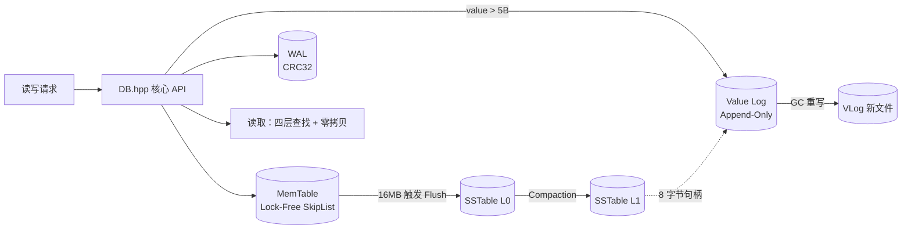

# ZeroKV 设计文档

> 一个面向学习与实践的单机 KV 存储引擎：LSM-Tree 架构 + WiscKey 风格 KV 分离。
> 本文档描述核心数据结构、各条数据路径、并发控制、崩溃恢复与已知权衡。

## 1. 概述

ZeroKV 是一个单机、可持久化的键值存储引擎，Key 为 `uint64_t`，Value 为任意字节串。核心设计决策：

1. **LSM-Tree**：写入先落内存（MemTable），再批量刷盘为有序文件（SSTable），用 Compaction 控制层数与写放大。
2. **KV 分离（WiscKey 风格）**：大于 5 字节的值不写进 SST，而是追加到独立的 Value Log；SST 里只存 8 字节句柄，把"大值"的写放大和读放大从 LSM 主路径上剥离。
3. **无锁内存结构**：MemTable 用无锁跳表 + 追加版本链，读多写少场景下避免全局锁。
4. **崩溃一致性**：WAL 先写日志，SST / MANIFEST 通过原子替换保证元数据不丢。

## 2. 架构总览



| 组件 | 职责 |
|---|---|
| `DB` | 对外 API、Flush/Compaction/GC 调度、恢复、MANIFEST |
| `WAL` | 预写日志：CRC 校验、尾部撕裂截断、轮转 |
| `MemTable`（无锁跳表） | 内存索引：CAS 插入 + 版本链 + EpochGuard 读保护 |
| `SSTable` | 磁盘有序文件：LZ4 块 + 重启点 + 前缀 Bloom + mmap |
| `ValueLog` | 大值追加日志：CRC + mmap 零拷贝读 |
| `ValueLogGC` | 按垃圾率回收 ValueLog 空间 |
| `CompactionTask` | 多路归并 + 去重 + 旧版本记账 + 写新 SST |
| `DBIterator` / `MergeIterator` | 范围扫描：四源归并 |
| `EpochManager` / `MemPool` / `ThreadPool` / `WriteController` | 无锁回收 / 线程本地内存 / 后台任务 / 写背压 |

## 3. 数据格式

### 3.1 DataHandle（64 位值句柄）

KV 分离的"指针"：一个 64 位整数编码了值的类型、位置与长度。

| 类型 | 编码 |
|---|---|
| inline（≤5B） | 值直接内联在句柄的字节里，`copy_inline_to` 取出 |
| vlog（>5B） | `(file_id, offset, len)` 三段位域，指向 ValueLog 中的记录 |
| tombstone | 删除标记 |

设计要点：句柄 64 位定长，SST / WAL 里存的是句柄而非值本身，元数据层体积与值大小解耦。

### 3.2 WAL 记录

变长记录：`[header + CRC32][seq][key][handle_raw(8B)][type]`。

- CRC 只覆盖数据段，校验失败即视为尾部撕裂，停止回放并截断。
- 记录追加后不立即 fsync（吞吐优先），由 `SyncWAL()` 显式刷盘。
- **Rotate 只在 SST `fdatasync` 之后**：保证 WAL 里始终是"尚未落 SST 的记录"。

### 3.3 SSTable

- 数据块：24B/条目（key + handle + seq），攒满 64KB 后 LZ4 压缩 + CRC。
- 每 16 条记一个 restart point，块内用重启点二分。
- 索引块：每块首 key，`upper_bound` 定位。
- 前缀 Bloom Filter：`(cache_ns, file_id, block_offset)` 维度，未命中直接跳过块解压。
- 读取：mmap 零拷贝 + 分片 LRU BlockCache（key = `cache_ns, file_id, block_offset`）。

### 3.4 ValueLog 记录

`[total_len][crc32][key_len][val_len][key][value]`，头 16 字节。

- Append-Only：顺序追加，不原地改。
- 轮转：`current_offset > 900MB`（软阈值）或 `offset + total_len > 1GB`（硬上限，受句柄 offset 30 位约束）。
- 读：`pin_external(base + header + key, len, mmap_holder)` 零拷贝。

## 4. 写入路径

```
DB::Put(key, value, len)
① shared_lock(gc_pause_mtx_)          // GC 期间写阻塞
② WriteController::ApplyBackpressure() // 背压（L0/imm 阈值）
③ seq = next_seq_.fetch_add(1)         // 全局单调版本号（MVCC 的根）
④ len > 5 ?
     是 → ValueLog::Append → make_vlog 句柄
     否 → make_inline（值内联）
⑤ WAL::Append(seq, key, handle, PUT)
⑥ LockFreeSkipList::Put(key, handle, seq)   // 返回被取代的旧版本
⑦ 旧版本是 vlog → AddDiscardableSize          // 垃圾记账
⑧ CheckFlush()                                // memtable_bytes ≥ 16MB → TriggerFlush
```

关键设计点：

- **写成功 = WAL 进 page cache**，不逐条 fsync；掉电丢最近未刷盘数据（吞吐优先，见 §11 已知限制 7）。
- **5 字节是 KV 分离边界**：≤5B 内联零 VLog 开销，>5B 走 VLog 多一次 CRC + write 系统调用。
- **锁顺序固定**：`gc_pause_mtx_`（最外层，GC 独占）→ `ValueLog::write_mtx_` → `WAL::mu_` → `memtable_mtx_`（仅换表时）。任何路径不得反序，否则死锁。

## 5. 读取路径

```
DB::Get(key) → GetZeroCopy → GetZeroCopyInternal
  ① MemTable 版本链取 max seq
  ② Immutable（新→旧）
  ③ L0（新→旧）：Bloom → 索引 → BlockCache → 重启点二分 → 块内扫描取 max seq
  ④ L1（有序，区间过滤后）
  ⑤ 跨层取 max seq；tombstone → false
  ⑥ inline → copy_inline_to；vlog → ValueLog::Read（mmap pin，零拷贝）
```

关键设计点：

- **可见性 = 各层中 seq 最大者**：同 key 多版本共存，读永远取最新。
- **零拷贝**：`GetZeroCopy` + `PinnableSlice` 直接 pin mmap，不整段拷贝；这是大值读吞吐的关键（§10）。
- **未命中极快**：前缀 Bloom 直接否定，不碰数据块（冷未命中 ≈ 热未命中）。

## 6. Flush 与 Compaction

### 6.1 Flush（MemTable → SSTable）

```
TriggerFlush()
  ① unique_lock(memtable_mtx_)：memtable_ = 新跳表，旧表进 imm_memtables_
  ② bg_pool_.enqueue(FlushMemTable(old))       // 异步
FlushMemTable(imm)
  ③ MemTableIterator 遍历 → SSTWriter 写块
  ④ Finish：fdatasync
  ⑤ l0_ssts_.push_back(meta)
  ⑥ imm_memtables_.erase(imm)
  ⑦ UpdateWriteControllerState()
  ⑧ WAL::Rotate()                              // SST 已 fdatasync，才敢清 WAL
  ⑨ MaybeScheduleCompaction()
```

设计要点：

- **Immutable MemTable 存在的理由**：无锁跳表读写并发，原地遍历写 SST 会看到"遍历到一半才插入的节点"。切成 immutable 后遍历安全，新写进新表不阻塞。
- **Flush 是异步的**：正常写不阻塞；若 Flush 慢、imm 堆积，WriteController 触发背压。

### 6.2 Compaction（L0 → L1）

```
触发条件：L0 文件数 ≥ 4，或 L1 内部重叠
  ① 选 source：L0 全部（或 L1 重叠对）+ 与之重叠的 L1
  ② CompactionTask::Execute：
       - MergeIterator 多路归并
       - 每个 key 先排空全部版本，取 max seq（不能假设堆顶即最新）
       - 被取代旧版本 → handle_obsolete → AddDiscardableSize
       - 底层墓碑 → 丢弃整个 key；上层墓碑保留
       - 保留 → handle_rewriter（GC RewriteMap）→ writer->Add
  ③ 替换 l0/l1 列表，按 min_key 排序
  ④ SaveManifestInternal()（原子替换）
  ⑤ 删除旧 SST 文件
```

关键修复（历史上踩过的坑）：`finish_current` 用 `GetEntryCount() > 0` 而非文件大小判断，避免小数据集 Compaction 丢数据。

## 7. ValueLog GC（五步协议）

```
DB::RunGC(force)
  ① PickGCFile(threshold)          // 跳过 current/gc 文件，按 discardable 比例选
  ② unique_lock(gc_pause_mtx_)     // 暂停所有写
  ③ FlushActiveMemTable + WaitForBackgroundJobs
  ④ ValueLogGC::RunOnce(checker)   // 扫描 + checker 逐条校验 + 重写 + rewrite_map
  ⑤ InjectRewriteMap → ForceGlobalCompaction  // SST 句柄改指新位置
  ⑥ RemoveFile(target_fid)
```

**崩溃窗口分析**（不变量 5：先新落盘、后删旧文件）：

- ④ 前崩溃 → 旧文件在、SST 指旧句柄，完整。
- ④ 后 ⑤ 前崩溃 → 新 VLog 文件已 CRC 可校验，旧文件删不删都无妨。
- 永远不存在"SST 指向已删除文件"的状态。

## 8. 崩溃恢复

```
DB::DB(dir)
  ① 建目录、BlockCache、NodePool
  ② ThreadPool(4, 钩子：Init/ReleaseThreadLocalPool)
  ③ ValueLog::RecoverAndTruncate()  // 逐文件 pread 扫 CRC，valid_size = 最后完整记录末尾
  ④ LoadManifest()                  // L0/L1 列表 + next_file_id + max_seq
  ⑤ WAL::Recover()                  // 逐条 CRC → 校验 VLog 边界 → memtable_->Put
  ⑥ next_seq_ = max(manifest_max, wal_max) + 1
  ⑦ 重建 WAL 对象（O_APPEND 继续写）
  ⑧ UpdateWriteControllerState + MaybeScheduleCompaction
```

**恢复顺序不可颠倒**（不变量 9）：VLog 截断 → MANIFEST → WAL 回放。原因：WAL 里的句柄依赖 VLog 的 `valid_size` 做边界校验，必须先定出 valid_size。

**幂等性**：WAL 只在 SST `fdatasync` 之后 Rotate，正常无重复；崩溃落在"fdatasync 后、Rotate 前"时，replay 会重放已落盘记录，但 seq 与句柄相同、逻辑幂等（多占一点内存，下次 Flush 合并）。

## 9. 并发控制

### 9.1 锁层级（固定顺序，防死锁）

```
gc_pause_mtx_（shared_mutex：写路径 shared_lock，GC unique_lock）
    → ValueLog::write_mtx_（大值）
    → WAL::mu_
    → memtable_mtx_（仅换表）
```

### 9.2 运行时组件

- **EpochManager**：无锁跳表删除节点后不能立即 free（可能有读者持有指针）。读者用 `EpochGuard`（RAII）进入保护，删除方 `retire` 挂起、`try_reclaim` 在 epoch 安全后回收。
- **MemPool**：线程本地内存池 + 跨线程窃取，减少 `malloc` 的锁竞争与碎片；ThreadPool 的 worker 创建/退出钩子负责 init/release。
- **ThreadPool**：基于 C++20 `jthread` 的后台任务池，Flush/Compaction 异步执行；`enqueue` + 优雅排空。
- **WriteController**：写背压状态机，依据 L0 文件数 / imm 表数调整写速率，防止 Flush 跟不上时内存暴涨。

## 10. 性能分析（火焰图）

用 `perf` + FlameGraph 对写/读路径分别采样（`zerokv_clean_perf`，20s 纯负载），结论：

### 写路径

| 函数 | 占比 | 说明 |
|---|---|---|
| `write` 系统调用（含 ext4 页缓存路径） | ~41% | 每条 WAL 记录一次 `write()` |
| `LockFreeSkipList::insert` | ~28% | 唯一的数据结构热点 |
| `__mark_inode_dirty` / `ext4_dirty_inode` | ~19% | 小写入的元数据税（每次更新 size/mtime + 日志） |
| 软件 CRC（libz） | ~8% | 可换硬件 CRC32C |

### 读路径（零拷贝）

| 函数 | 占比 | 说明 |
|---|---|---|
| `SSTReader::Get` | ~44% | Bloom → 索引 → BlockCache → 解压 |
| `shared_mutex` 读锁 | ~11% | BlockCache 命中路径读锁 |
| `shared_ptr` 引用计数 | ~9% | 块缓存持有/释放 churn |
| `LockFreeSkipList::GetHandle` | ~2.8% | 无锁跳表读，非瓶颈 |

### 优化方向（按收益）

1. WAL group commit：批量写摊薄元数据税（19% / 批量大小）。
2. 硬件 CRC32C：替换软件 CRC，写 -7%。
3. BlockCache 命中路径去锁 + 去 shared_ptr churn（复用 EpochManager），读 -20%。

## 11. 已知权衡

1. Key 固定 `uint64_t`（通用 Slice/字符串 Key 在 Roadmap）。
2. 前缀 Bloom 的假阳性率由前缀数量决定而非 key 数量；换体积更小、构建去重。
3. 范围扫描无快照隔离；单次 key/value 读是原子的。
4. 单日志串行写：并发写吞吐受限（group commit / 多段 VLog 在 Roadmap）。
5. discardable 记账是启发式，GC 扫描以 checker 逐条校验为准；崩溃后从零重建，不影响正确性。
6. 仅支持 Linux；MANIFEST 记绝对路径。
7. 崩溃注入仅覆盖单写线程；断电安全性是设计论证 + fdatasync 推理，未做真实掉电实测。

## 12. 不变量

1. seq 全局单调递增；读到的版本 = 各层 seq 最大者。
2. 版本链节点链接后不可变；同 key 版本连续。
3. WAL 只在 Flush 的 `fdatasync` 之后 Rotate。
4. MANIFEST 走 `tmp + fdatasync + rename + 目录 fsync`。
5. GC / Compaction 统一"先新落盘、后删旧文件"。
6. BlockCache key = `(cache_ns, file_id, block_offset)`。
7. Flush 期间旧 MemTable 不可写；GC 期间全局暂停写。
8. discardable 记账是启发式，checker 是权威。
9. 恢复顺序：VLog 截断 → MANIFEST → WAL 回放，不可颠倒。
10. 归并必须排空取 max seq，不能假设堆顶即最新。
